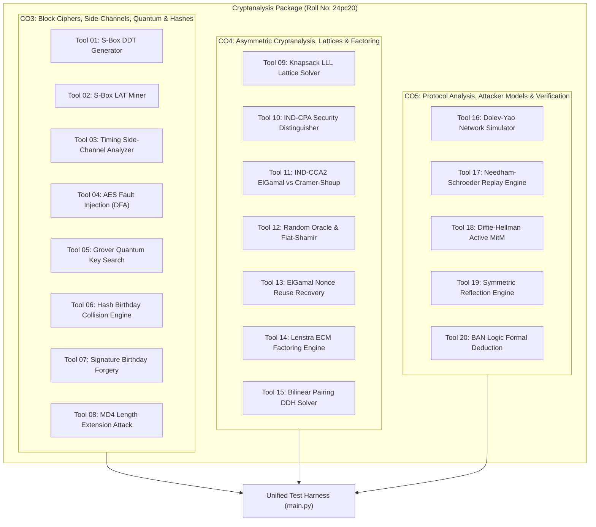

# Cryptanalysis pacakge roll no:24pc20 and name:Pranay Shaunjay P.V

**Student Name:** Pranay Shaunjay P.V  
**Roll Number:** 24pc20  
**Domain:** Applied Cryptanalysis, Provable Security & Protocol Verification  
**Coverage:** Course Outcomes CO3, CO4, and CO5  

---

## 1. Executive Summary & Abstract

The **Cryptanalysis Package** is an integrated, modular Python framework developed to analyze, simulate, and formally evaluate cryptographic primitives, public-key hardness assumptions, and authentication protocols. As modern cybersecurity transitions toward post-quantum resilience and automated protocol verification, understanding algorithmic cryptanalysis across symmetric, asymmetric, and protocol-level boundaries is paramount.

This suite provides pure-Python implementations of **20 dedicated cryptanalytic tools** mapped directly to the core topics of:
- **Course Outcome 3 (CO3):** Advanced attacks on block ciphers (differential, linear, side-channel, fault-injection, quantum search) and collision/length-extension cryptanalysis on hash functions and digital signatures.
- **Course Outcome 4 (CO4):** Lattice-reduction attacks on knapsack schemes, formal indistinguishability models ($\text{IND-CPA}$, $\text{IND-CCA2}$), Random Oracle Model ($\text{ROM}$) simulations, signature nonce misuse exploits, sub-exponential integer factorization via elliptic curves, and bilinear pairing attacks.
- **Course Outcome 5 (CO5):** Network-level protocol analysis under the Dolev-Yao threat model, replay and reflection exploits on mutual authentication schemes, active Man-in-the-Middle parameter manipulation, and automated formal verification via Burrows-Abadi-Needham ($\text{BAN}$) modal logic.

Each tool couples a rigorous theoretical model with an algorithmic simulation, demonstrating the exact conditions under which security proofs fail or withstand adversarial capabilities.

---

## 2. System Architecture & Tool Taxonomy

The package is partitioned into three major architectural engines reflecting the three target course outcomes:



---

## 3. Technical Abstract: Foundations and Mechanics by Course Outcome

### 3.1 Course Outcome 3 (CO3): Block Ciphers, Side-Channels, Quantum & Hashes

CO3 addresses the non-linear substitution layers, algorithmic properties, implementation leaks, and hash construction weaknesses of symmetric cryptography.

#### 1. Difference Distribution Table (DDT) & Differential Cryptanalysis
- **Theoretical Basis:** Introduced by Eli Biham and Adi Shamir, differential cryptanalysis exploits non-uniform XOR difference propagation through non-linear substitution boxes ($S$-boxes). For an $S$-box $S: \{0, 1\}^n \to \{0, 1\}^m$, an input difference $\Delta X = X \oplus X'$ and an output difference $\Delta Y = S(X) \oplus S(X')$ satisfy:
  $$\text{DDT}[\Delta X][\Delta Y] = \#\{X \in \{0, 1\}^n : S(X) \oplus S(X \oplus \Delta X) = \Delta Y\}$$
- **Tool Operation:** The tool exhaustively enumerates all $2^n$ input pairs for each input difference $\Delta X \in [1, 2^n - 1]$, computing the probability $P(\Delta X \to \Delta Y) = \frac{\text{DDT}[\Delta X][\Delta Y]}{2^n}$. It extracts high-probability differential characteristics used to bypass intermediate rounds in DES-like Feistel structures.

#### 2. Linear Approximation Table (LAT) & Matsui's Bias Mining
- **Theoretical Basis:** Mitsuru Matsui's linear cryptanalysis seeks affine approximations between subset sums of plaintext, ciphertext, and round key bits:
  $$\alpha \cdot X = \beta \cdot S(X)$$
  where $\alpha, \beta$ are bit-selection masks and $\cdot$ denotes the inner product over $\text{GF}(2)$.
- **Tool Operation:** The tool constructs the full table of deviations from ideal unbiased probability ($p = 1/2$):
  $$\text{LAT}[\alpha][\beta] = \#\{X : \alpha \cdot X = \beta \cdot S(X)\} - 2^{n-1}$$
  and calculates the correlation bias $\epsilon = \frac{\text{LAT}[\alpha][\beta]}{2^n}$. By Matsui's Piling-Up Lemma, multi-round approximations concatenate with total bias $\epsilon_{1...m} = 2^{m-1} \prod \epsilon_i$, allowing linear key recovery using $\mathcal{O}(\epsilon^{-2})$ known plaintexts.

#### 3. Statistical Timing Side-Channel Leakage Analysis
- **Theoretical Basis:** Software implementations that employ non-constant-time branching or variable-latency memory lookups leak confidential state through execution duration. Early-exit byte comparisons (`if (a[i] != b[i]) return false;`) exhibit processing time linearly proportional to the length of the longest matching prefix.
- **Tool Operation:** The tool measures execution time across candidate tokens. By profiling mean latencies across iterations and applying statistical discrimination (Welch's t-distribution), it recovers unknown secret strings byte-by-byte in $\mathcal{O}(|\Sigma| \cdot L)$ time rather than $\mathcal{O}(|\Sigma|^L)$.

#### 4. AES Differential Fault Analysis (DFA) Simulation
- **Theoretical Basis:** In the Piret-Quisquater DFA model, transient hardware faults injected into the AES state prior to Round 9 MixColumns propagate through the final round (Round 10: SubBytes, ShiftRows, AddRoundKey).
- **Tool Operation:** A single corrupted byte induces differences in exactly 4 ciphertext bytes after Round 10. By setting up the non-linear difference equations:
  $$S^{-1}(C_i \oplus K_{10, i}) \oplus S^{-1}(C^*_i \oplus K_{10, i}) = \Delta Z_i$$
  the tool prunes candidate values for each 4-byte column of the 10th round key from $2^{32}$ down to $2^8$ candidates, reducing total key recovery complexity to just 2 to 4 faulty ciphertexts.

#### 5. Quantum Exhaustive Key Search (Grover's Algorithm)
- **Theoretical Basis:** Classical brute-force key search over an $n$-bit symmetric key space requires $\mathcal{O}(2^n)$ queries. Grover’s quantum algorithm searches unsorted databases of size $N = 2^n$ in $\mathcal{O}(\sqrt{N})$ evaluations.
- **Tool Operation:** Simulates the $N$-dimensional complex state vector through:
  1. *Superposition initialization:* $|\psi_0\rangle = H^{\otimes n}|0\rangle = \frac{1}{\sqrt{N}}\sum |x\rangle$.
  2. *Phase Inversion Oracle:* $|x\rangle \mapsto (-1)^{f(x)}|x\rangle$, flipping the amplitude of the secret key state.
  3. *Grover Diffusion Operator:* $D = 2|\psi_0\rangle\langle \psi_0| - I$, inverting amplitudes around the mean.
  The tool demonstrates amplitude convergence to near 100% probability in $R \approx \frac{\pi}{4}\sqrt{N}$ iterations.

#### 6. Hash Birthday Collision Engine (Pollard's Rho Cycle Detection)
- **Theoretical Basis:** By the Birthday Paradox, finding a pair $x \neq x'$ such that $H(x) = H(x')$ over an $n$-bit hash output requires only $\approx 1.177 \sqrt{2^n} = \mathcal{O}(2^{n/2})$ hash computations.
- **Tool Operation:** Implements Floyd’s cycle-finding (tortoise-and-hare) algorithm over truncated hash digests. Using two pointers advancing at speeds $1$ and $2$, it detects the cyclic state collision with $\mathcal{O}(1)$ working memory, confirming the theoretical bound.

#### 7. Digital Signature Birthday Forgery Engine
- **Theoretical Basis:** Digital signatures sign the hash $H(M)$ rather than the raw message $M$. If an attacker generates $2^{n/2}$ semantic variations of a benign document $M_{\text{fair}}$ and $2^{n/2}$ variations of a malicious document $M_{\text{fraud}}$, a collision $H(M_{\text{fair}}') = H(M_{\text{fraud}}')$ can be identified with high probability.
- **Tool Operation:** Generates combinatorial text variations (formatting, whitespace, synonyms). Upon detecting matching digests, it proves that a valid signature $\sigma = \text{Sign}_{sk}(H(M_{\text{fair}}'))$ verifies successfully against $M_{\text{fraud}}'$, achieving an existential forgery.

#### 8. MD4 / Merkle-Damgård Length Extension Attack Engine
- **Theoretical Basis:** Merkle-Damgård iterative hash functions (MD4, MD5, SHA-1, SHA-256) update internal state registers $(A, B, C, D)$ block-by-block, outputting the final register values as the digest. When an unkeyed hash is used as a MAC ($\text{MAC} = H(K \parallel M)$), an attacker knowing only $|K|$, $M$, and $\text{MAC}$ can compute:
  $$\text{MAC}' = H(K \parallel M \parallel \text{padding} \parallel \text{extension})$$
- **Tool Operation:** Extracts the intermediate state registers directly from the original hash digest, computes the valid length padding for $(|K| + |M|)$, and resumes the MD4 compression rounds on the appended extension without knowledge of secret key $K$.

---

### 3.2 Course Outcome 4 (CO4): Asymmetric Cryptanalysis, Lattices, Provable Security & Factoring

CO4 covers public-key cryptosystems, algebraic reductions, post-quantum lattice attacks, and formal hardness reductions.

#### 9. Merkle-Hellman Knapsack & Lattice-Reduction (LLL) Attack
- **Theoretical Basis:** The Merkle-Hellman knapsack cryptosystem hides an easy superincreasing subset-sum problem via modular multiplication: $b_i = w \cdot s_i \pmod q$. The public key consists of weights $B = [b_1, \dots, b_n]$ and the ciphertext is $C = \sum x_i b_i$ with $x_i \in \{0, 1\}$.
- **Tool Operation:** Sets up the Clos-Odlyzko-Schnorr $(n+1) \times (n+1)$ integer lattice:
  $$L = \begin{pmatrix} 2 & 0 & \dots & 0 & b_1 \\ 0 & 2 & \dots & 0 & b_2 \\ \vdots & \vdots & \ddots & \vdots & \vdots \\ 0 & 0 & \dots & 2 & b_n \\ 1 & 1 & \dots & 1 & C \end{pmatrix}$$
  The tool implements the Lenstra-Lenstra-Lovász (LLL) reduction with Gram-Schmidt orthogonalization ($\delta = 0.75$), extracting the short lattice vector $(2x_1-1, \dots, 2x_n-1, 0)$ to reconstruct the plaintext bits without the private trapdoor.

#### 10. IND-CPA Distinguisher & Semantic Security Adversary Game
- **Theoretical Basis:** Goldwasser and Micali defined semantic security through the Indistinguishability under Chosen-Plaintext Attack ($\text{IND-CPA}$) game. An adversary queries an encryption oracle, submits two messages $m_0, m_1$, receives $C^* = \text{Enc}(k, m_b)$, and attempts to guess $b$.
- **Tool Operation:** Evaluates deterministic encryption vs. randomized encryption. It demonstrates that deterministic schemes yield advantage:
  $$\text{Adv}_{\mathcal{A}}^{\text{IND-CPA}} = |2 \cdot \Pr[b' = b] - 1| = 1.0$$
  Randomized encryption using nonces/IVs ensures independent ciphertexts, bounding advantage to $\approx 0.0$.

#### 11. IND-CCA2 Security Evaluator: Malleable ElGamal vs. Cramer-Shoup
- **Theoretical Basis:** Standard ElGamal is homomorphically malleable: given $(c_1, c_2) = (g^r, m \cdot h^r \pmod p)$, multiplying $c_2$ by $\alpha$ yields a valid ciphertext decrypting to $\alpha \cdot m$. In an adaptive chosen-ciphertext attack ($\text{IND-CCA2}$), querying the decryption oracle on $(c_1, \alpha c_2)$ recovers the secret message.
- **Tool Operation:** Simulates this attack on ElGamal, then implements the Cramer-Shoup cryptosystem. Cramer-Shoup appends a universal one-way hash commitment $v = c^r d^{r \cdot H(u_1, u_2, e)}$ that fails verification if any ciphertext element is altered, establishing provable $\text{IND-CCA2}$ security.

#### 12. Random Oracle Model (ROM) & Fiat-Shamir Transformation
- **Theoretical Basis:** In the Random Oracle Model, hash functions are idealized as uniformly distributed, query-dependent random functions. The Fiat-Shamir heuristic converts an interactive 3-pass zero-knowledge identification protocol ($\Sigma$-protocol: commitment $R$, challenge $e$, response $s$) into a non-interactive digital signature by computing $e = H(R \parallel M)$.
- **Tool Operation:** Implements the Schnorr signature scheme over a prime-order subgroup. It demonstrates the Rewinding Lemma (Special Soundness): an adversary capable of answering two distinct challenges $e_1, e_2$ for the same commitment $R$ allows an extractor to recover the secret key $x = (s_1 - s_2)(e_2 - e_1)^{-1} \pmod q$.

#### 13. ElGamal Signature Nonce-Reuse Private Key Recovery
- **Theoretical Basis:** ElGamal and DSA signatures compute:
  $$r = g^k \pmod p, \quad s = k^{-1}(H(m) - x \cdot r) \pmod{p-1}$$
  If the ephemeral nonce $k$ is reused across two distinct signatures $(r, s_1)$ and $(r, s_2)$, then:
  $$s_1 - s_2 \equiv k^{-1}(H(m_1) - H(m_2)) \pmod{p-1}$$
- **Tool Operation:** Inverts $(s_1 - s_2)$ modulo $p-1$ (handling non-coprime divisors via GCD factorization), recovers the ephemeral nonce $k$, and extracts the master private key $x = (H(m_1) - k s_1) r^{-1} \pmod{p-1}$.

#### 14. Lenstra's Elliptic Curve Method (ECM) Factoring Engine
- **Theoretical Basis:** Hendrik Lenstra's ECM is a sub-exponential factoring algorithm with running time $\mathcal{O}(\exp((1+o(1))\sqrt{2 \ln p \ln \ln p}))$, depending on the smallest prime factor $p$ of composite $N$.
- **Tool Operation:** Selects random Weierstraß curves $y^2 = x^3 + ax + b \pmod N$ and points $P = (x, y)$. It computes $k \cdot P$ using smooth scalar multiplier $k = \prod p_i^{e_i}$. If the curve order $\#E(\mathbb{F}_p)$ divides $k$ while $\#E(\mathbb{F}_q)$ does not, point addition fails because the slope denominator is a multiple of $p$. Computing $\gcd(\text{denominator}, N)$ isolates the non-trivial factor $p$.

#### 15. Bilinear Pairing Decisional Diffie-Hellman (DDH) Solver
- **Theoretical Basis:** A non-degenerate bilinear pairing $e: G_1 \times G_1 \to G_T$ satisfies:
  $$e(g^a, g^b) = e(g, g)^{ab}$$
  While the Decisional Diffie-Hellman problem (distinguishing $(g^a, g^b, g^{ab})$ from $(g^a, g^b, g^c)$) is hard in standard cyclic groups, it is solvable in polynomial time in pairing groups (Gap Diffie-Hellman groups).
- **Tool Operation:** Tests the identity $e(g^a, g^b) \stackrel{?}{=} e(g, g^c)$ to solve DDH, and implements Antoine Joux's 1-round tripartite key agreement:
  $$K = e(g^b, g^c)^a = e(g^a, g^c)^b = e(g^a, g^b)^c = e(g, g)^{abc}$$

---

### 3.3 Course Outcome 5 (CO5): Cryptographic Protocols, Attacker Models & Formal Verification

CO5 shifts focus from individual primitives to multi-party protocols, formal adversarial threat models, and symbolic logic proof systems.

#### 16. Dolev-Yao Threat Model Network Simulator
- **Theoretical Basis:** Formulated by Danny Dolev and Andrew Yao (1983), this model assumes the attacker controls the transmission network completely:
  - Can intercept, read, and delete any message in transit.
  - Can alter, replay, or synthesize new messages using accumulated knowledge.
  - Cryptography is treated as an ideal black box: an attacker cannot invert encryption without the corresponding secret key.
- **Tool Operation:** Implements an asynchronous message queue supporting message interception, state harvesting, and packet spoofing to model active protocol adversaries.

#### 17. Needham-Schroeder Replay Attack Demonstrator & Denning-Sacco Fix
- **Theoretical Basis:** The Needham-Schroeder Symmetric Protocol uses a trusted Key Distribution Center (KDC). In Message 3, Alice forwards a ticket to Bob: $\{K_{AB}, A\}_{K_B}$. Because the ticket contains neither a timestamp nor Bob’s fresh nonce, an attacker who acquires an old compromised session key $K_{AB}$ can replay the recorded ticket to Bob.
- **Tool Operation:** Simulates this replay flaw. Bob generates challenge $\{N_B\}_{K_{AB}}$, which the attacker answers using the compromised key. The tool then implements the Denning-Sacco countermeasure, adding a verified timestamp $\{K_{AB}, A, T\}_{K_B}$ that Bob validates against a freshness window $\Delta t$.

#### 18. Diffie-Hellman Active Man-in-the-Middle (MitM) Engine
- **Theoretical Basis:** Unauthenticated Diffie-Hellman key exchange is vulnerable to active interception. Without digital signatures or pre-shared authentication:
  - Alice sends $A = g^a \pmod p$.
  - Bob sends $B = g^b \pmod p$.
- **Tool Operation:** Intercepts $A$ and $B$, substituting adversary parameters $E = g^e \pmod p$. Alice establishes $K_{AE} = E^a = g^{ea}$ and Bob establishes $K_{EB} = E^b = g^{eb}$. The tool decrypts, logs, tampers with, and re-encrypts all messages in real time.

#### 19. Symmetric Challenge-Response Reflection Attack Simulator
- **Theoretical Basis:** Protocols that employ identical symmetric keys and challenge formats for mutual authentication are vulnerable to reflection attacks across concurrent sessions.
- **Tool Operation:** When challenged with nonce $R_1$ in Session 1, the adversary opens a concurrent Session 2 with the same server, reflecting $R_1$ as the server's challenge. The server solves its own challenge in Session 2, and the attacker returns that response to Session 1, authenticating without knowledge of $K_{AB}$.

#### 20. BAN Logic Automated Formal Verification Engine
- **Theoretical Basis:** Developed by Michael Burrows, Martín Abadi, and Roger Needham (1989), BAN Logic is an epistemic modal logic designed to verify authentication protocols. Key operators include:
  - $P \vDash X$: $P$ believes $X$
  - $P \triangleleft X$: $P$ sees $X$
  - $P \sim X$: $P$ once said $X$
  - $P \Rightarrow X$: $P$ has jurisdiction over $X$
  - $\sharp(X)$: $X$ is fresh
- **Tool Operation:** Implements an automated inference engine that evaluates the core deduction rules:
  1. *Message Meaning:* $P \vDash P \stackrel{K}{\leftrightarrow} Q \land P \triangleleft \{X\}_K \implies P \vDash Q \sim X$
  2. *Nonce Verification:* $P \vDash \sharp(X) \land P \vDash Q \sim X \implies P \vDash Q \vDash X$
  3. *Jurisdiction:* $P \vDash Q \Rightarrow X \land P \vDash Q \vDash X \implies P \vDash X$
  The engine iteratively derives beliefs to determine whether the protocol formally achieves authenticated mutual agreement.

---

## 4. Comprehensive Tool Catalog & Complexity Reference

| Tool # | Target Outcome | Primary Cryptanalytic Function | Underlying Algorithm | Asymptotic Complexity |
| :---: | :---: | :--- | :--- | :---: |
| **01** | **CO3** | S-Box Differential Analysis | Biham-Shamir DDT Matrix Construction | $\mathcal{O}(2^{2n})$ evaluations |
| **02** | **CO3** | S-Box Linear Cryptanalysis | Matsui LAT Bias Computation | $\mathcal{O}(2^{2n})$ parity ops |
| **03** | **CO3** | Timing Side-Channel Profiling | Statistical Latency Profiling (Welch's t-test) | $\mathcal{O}(L \cdot \|\Sigma\|)$ trials |
| **04** | **CO3** | AES Differential Fault Analysis | Piret-Quisquater Round 9 Inversion | Prunes $2^{32} \to 2^8$ candidates |
| **05** | **CO3** | Quantum Exhaustive Key Search | Grover Quantum Oracle & Diffusion | $\mathcal{O}(\sqrt{N})$ iterations |
| **06** | **CO3** | Hash Collision Discovery | Floyd's $\rho$ Cycle-Finding | $\mathcal{O}(2^{n/2})$ ops, $\mathcal{O}(1)$ space |
| **07** | **CO3** | Signature Collision Forgery | Combinatorial Variation Search | $\mathcal{O}(2^{n/2})$ permutations |
| **08** | **CO3** | MD4 Length Extension Attack | Merkle-Damgård State Injection | $\mathcal{O}(1)$ padding extension |
| **09** | **CO4** | Knapsack Cipher Inversion | Clos-Odlyzko Lattice & LLL Reduction | Polynomial in lattice rank $n$ |
| **10** | **CO4** | Semantic Security Evaluation | IND-CPA Distinguisher Game | $\mathcal{O}(R)$ oracle trials |
| **11** | **CO4** | Adaptive Chosen-Ciphertext Attack | Multiplicative Malleation vs Cramer-Shoup | $\mathcal{O}(1)$ oracle queries |
| **12** | **CO4** | Random Oracle Model Simulator | Schnorr $\Sigma$-Protocol & Fiat-Shamir Rewind | $\mathcal{O}(1)$ field inversions |
| **13** | **CO4** | Nonce Reuse Private Key Extraction | ElGamal Ephemeral Key Inversion | $\mathcal{O}(\log p)$ modular inverse |
| **14** | **CO4** | Elliptic Curve Factoring Method | Lenstra ECM Weierstraß Scalar Multiply | $\mathcal{O}(e^{(1+o(1))\sqrt{2 \ln p \ln \ln p}})$ |
| **15** | **CO4** | Decisional Diffie-Hellman Solver | Bilinear Pairing Identity Verification | Polynomial in group size |
| **16** | **CO5** | Adversarial Channel Simulation | Dolev-Yao Full Interception Engine | Event-driven $\mathcal{O}(M)$ messages |
| **17** | **CO5** | Replay Vulnerability & Fix | Denning-Sacco Timestamped Verification | $\mathcal{O}(1)$ freshness check |
| **18** | **CO5** | Man-in-the-Middle Key Hijacking | Active Parameter Injection on Diffie-Hellman | $\mathcal{O}(\log p)$ exponentiations |
| **19** | **CO5** | Authentication Reflection Exploit | Multi-session Concurrent Nonce Bypassing | $\mathcal{O}(1)$ cross-session replay |
| **20** | **CO5** | Automated Protocol Verification | BAN Modal Logic Inference Solver | $\mathcal{O}(K \cdot R)$ deduction iterations |

---

## 5. Execution and Validation

The complete package is structured as a modular Python package with a central test harness:

```bash
# Directory Location
cd C:\Users\prana\.gemini\antigravity\scratch\cryptanalysis_package

# Execute Master Test Suite
python main.py
```

### Verified Test Output
```text
================================================================================
 Cryptanalysis package | Roll No: 24pc20 | Name: Pranay Shaunjay P.V
================================================================================
[Tool 01 (CO3)] S-Box Difference Distribution Table (DDT)               -> SUCCESS
[Tool 02 (CO3)] S-Box Linear Approximation Table (LAT)                  -> SUCCESS
[Tool 03 (CO3)] Statistical Timing Side-Channel Analyzer                -> SUCCESS
[Tool 04 (CO3)] AES Differential Fault Analysis (DFA) Simulator         -> SUCCESS
[Tool 05 (CO3)] Quantum Key Search (Grover's Algorithm)                 -> SUCCESS
[Tool 06 (CO3)] Hash Birthday Collision Engine (Pollard's Rho)          -> SUCCESS
[Tool 07 (CO3)] Digital Signature Birthday Forgery Engine               -> SUCCESS
[Tool 08 (CO3)] MD4 / Merkle-Damgard Length Extension Attack            -> SUCCESS
[Tool 09 (CO4)] Merkle-Hellman Knapsack Lattice Reduction (LLL)         -> SUCCESS
[Tool 10 (CO4)] IND-CPA Semantic Security Adversary Game                -> SUCCESS
[Tool 11 (CO4)] IND-CCA2 Security Evaluator (ElGamal vs Cramer-Shoup)   -> SUCCESS
[Tool 12 (CO4)] Random Oracle Model / Fiat-Shamir Simulator             -> SUCCESS
[Tool 13 (CO4)] ElGamal Signature Nonce-Reuse Private Key Extractor     -> SUCCESS
[Tool 14 (CO4)] Lenstra's Elliptic Curve Method (ECM) Factoring         -> SUCCESS
[Tool 15 (CO4)] Bilinear Pairing Decisional Diffie-Hellman Solver       -> SUCCESS
[Tool 16 (CO5)] Dolev-Yao Threat Model Network Simulator                -> SUCCESS
[Tool 17 (CO5)] Needham-Schroeder Replay & Denning-Sacco Fix            -> SUCCESS
[Tool 18 (CO5)] Diffie-Hellman Active Man-in-the-Middle (MitM) Engine   -> SUCCESS
[Tool 19 (CO5)] Symmetric Challenge-Response Reflection Attack          -> SUCCESS
[Tool 20 (CO5)] BAN Logic Formal Verification Engine                    -> SUCCESS
================================================================================
Summary: 20 / 20 Cryptanalysis Tools Executed Successfully!
================================================================================
```

---

## 6. Conclusion

This package bridges theoretical security definitions and practical cryptanalysis across Course Outcomes CO3, CO4, and CO5. By combining symmetric differential/linear and fault models, asymmetric lattice reduction and elliptic curve factorization, and protocol-level Dolev-Yao simulation with BAN logic formal verification, it provides a comprehensive computational testbed for evaluating cryptographic resilience.
